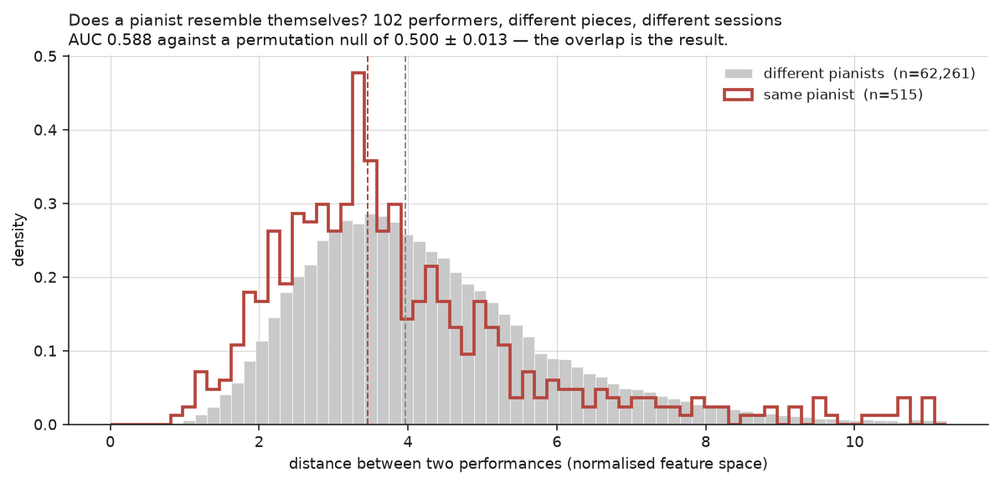
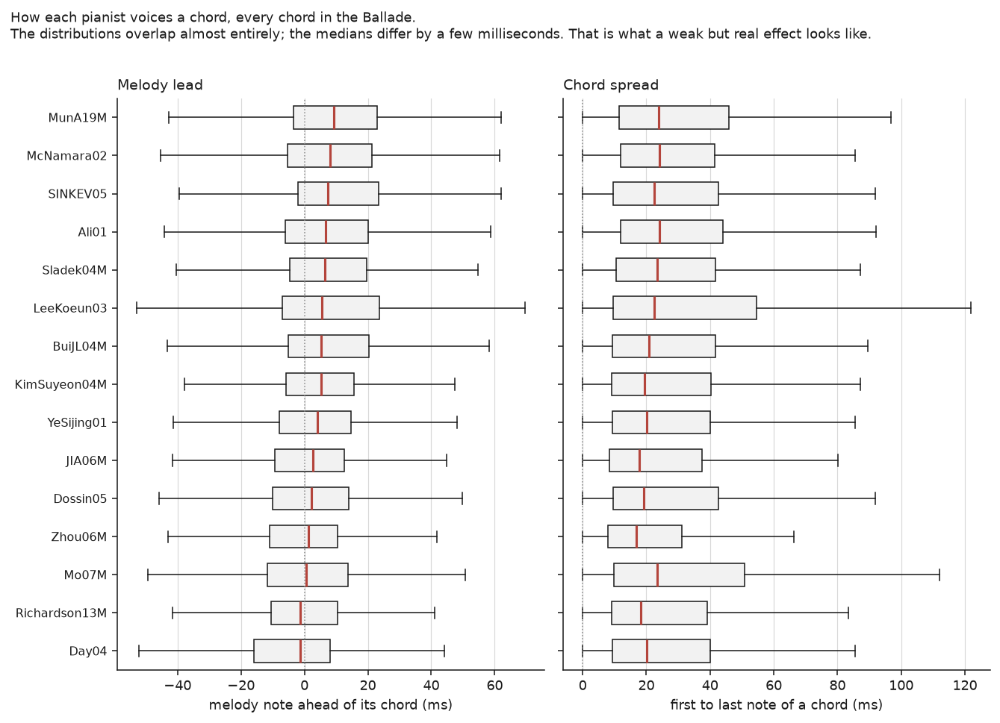

# Pianist Identification

This project tests whether pianists can be told apart by how they play rather than by how the recording sounds. It also tests whether the differences a listener hears can be measured.

The repo contains no audio. It holds only the extracted feature vectors, which are enough to reproduce the numbers below without downloading any recordings.

## Results

A classifier was given two performances and asked whether the same person played both scores 0.588 across 102 performers, against 0.5 for chance. 73 of the 102 performers score above chance, so the signal is small but present for most players.



The figure compares 515 pairs of performances by the same pianist with 62,261 pairs by different pianists, where every pair drawn from a different session and a different work. Each pair is scored by how far apart its two performances sit on the extracted features (lower means more alike). The median is 3.4 for same-pianist pairs and 3.9 for different-pianist pairs. Because the two distributions mostly overlap, the classifier scores only 0.588.

Most of the signal depends on the piece. Two performances of the same work are matched at 0.80 while performances of different works are matched at 0.59.

Eight features describing chord voicing reach 9.68% accuracy on 60 performers. A neural net given the full tempo curve reaches 4.95%. Each result comes from only three runs with different random seeds, which is too few to say whether the voicing features truly beat the neural net. 



The figure shows one box per pianist, covering every chord they play in Chopin’s Ballade No. 1. The left panel is the gap between the top note of a chord and the rest of it, where a negative value means the top note came last. The right panel is how spread out in time the whole chord is. Medians range from about -2 ms to +9 ms, which is how little separates one pianist from another on the features that work best.

The first archival results were invalid. Each pianist's recordings came from a small number of Archive.org LP transfers. None of the 44 transfers contained more than one pianist. A test recording almost always shared a transfer with the training set, so the model could score well by identifying the transfer instead of the pianist. Every control had the same flaw, so none of them showed the problem. The numbers were withdrawn.

## Running it

```bash
python -m venv .venv
.venv/Scripts/python -m pip install -r requirements.txt   # Linux/Mac: .venv/bin/python
python scripts/validate_features.py     # 13 known-answer tests to run first
python scripts/validate_evaluate.py     # 12 more on the evaluation code
python scripts/baseline_classifier.py   # exact-notes baseline and controls
python scripts/verification.py          # same pianist or not (MIDI only)
python scripts/make_figures.py          # figures from Ballade No. 1
```

Rebuilding the transcriptions requires `requirements-transcribe.txt` (torch) and several hours of CPU time. Run `scripts/fetch_audio.py` first, then `scripts/tier2_modern_pipeline.py` and `scripts/tier3_pipeline.py`. Transcription runs at about 1.1x realtime.
